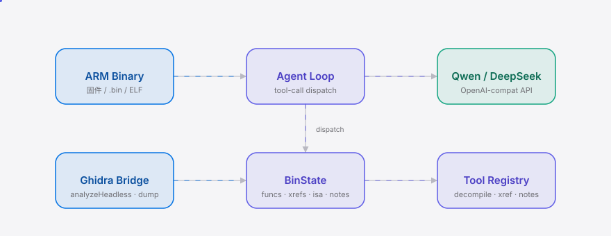
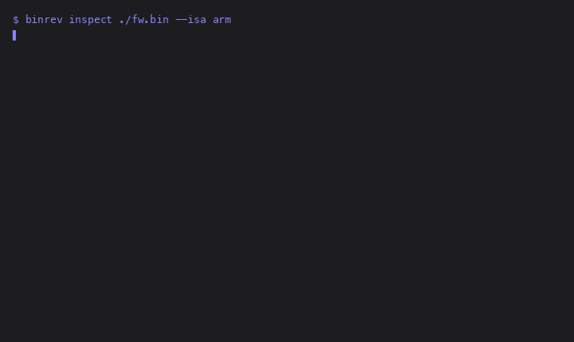

**English** | [简体中文](./README.md)

<picture>
  <source media="(prefers-color-scheme: dark)" srcset="./assets/hero-dark.svg">
  <source media="(prefers-color-scheme: light)" srcset="./assets/hero-light.svg">
  
</picture>

<p align="center"><sub>The binary-action-space agent that extends Claude Code into domestic-SoC firmware reverse engineering.</sub></p>

<p align="center">
  <a href="./LICENSE"></a>
  <a href="https://github.com/SuperMarioYL/binrev/releases"></a>
  <a href="https://github.com/SuperMarioYL/binrev/actions/workflows/ci.yml"></a>
  
  
  
</p>

> **The decompiled graph, cross-references and ISA state are first-class context for the agent — not Ghidra's stdout log.**

<h2> Architecture</h2>

<picture>
  <source media="(prefers-color-scheme: dark)" srcset="./assets/atlas-dark.svg">
  <source media="(prefers-color-scheme: light)" srcset="./assets/atlas-light.svg">
  
</picture>

A single Python process, one `BinState` per binary. Ghidra is invoked as an external tool via subprocess (never in-process). The agent reads and writes the `BinState` through a binary action space (`decompile` / `xref` / `list_funcs` / `search_strings` / `set_note`) instead of feeding Ghidra stdout to the model as text.

<h2> Why now</h2>

Qwen 3.8 27B finished a reverse-engineering job in 30 minutes, proving model capability has crossed the "can do non-trivial RE" threshold — the bottleneck has shifted from "can the model understand binaries" to "can the agent's action space carry binary state". [affaan-m/ECC](https://github.com/affaan-m/ECC) has been mapping the Claude Code action-space frontier, and binrev extends it into binary RE: the decompiled graph, xrefs and ISA state become first-class objects the agent can query and mutate. Domestic SoCs, head-unit ECUs and 信创 firmware ship as binaries with scarce public symbols, so this CN surface sits on a binary-action primitive the whole world is missing — not a "Chinese UI" localization that gets copied in one click.

### vs Claude Code + Ghidra CLI

| Axis | Claude Code + Ghidra CLI | binrev |
|---|---|---|
| Action space | text / shell (✓ general) | binary objects (✓) |
| Decompiled graph as context | ✗ reads stdout | ✓ first-class object |
| Cross-reference traversal | ✗ manual | ✓ agent-driven |
| ISA / calling-convention state | ✗ | ✓ |
| Domestic models (Qwen / DeepSeek) | — | ✓ |
| General code reasoning | ✓ (strong) | — (binary only) |

<h2> Install</h2>

```bash
python3 -m venv .venv && .venv/bin/pip install -e '.[dev]'   # or pipx install binrev
```

> v0.1 depends on capstone (pip installs it automatically). Ghidra is an optional backend — without it, `inspect` still works via capstone disassembly.

<h2> Quickstart</h2>

```bash
# 1. Build a minimal ARM firmware sample
python3 -c "import struct; open('fw.bin','wb').write(b''.join(struct.pack('<I',i) for i in [0xE92D4010,0xEB000001,0xE59F0010,0xE8BD8010,0xE92D4010,0xE3A0002A,0xE8BD8010]))"

# 2. Inspect the structured binary state (function table + xrefs)
binrev inspect ./fw.bin --isa arm

# 3. Read a called function's decompilation
binrev inspect ./fw.bin --isa arm --func 0x10
```

<details><summary>sample output</summary>

```
binrev inspect · ARM (A32) · 2 funcs · 1 xrefs · 0 strings · 0 notes · src=capstone

addr         name                   size  callers
--------------------------------------------------------
0x00000000  entry                    16  0
0x00000010  sub_00000010             12  1

function sub_00000010 @ 0x00000010  (12 bytes)

callers:
  0x00000004  (call)

decompilation:
  0x00000010:  push   {r4, lr}
  0x00000014:  mov    r0, #0x2a
  0x00000018:  pop    {r4, pc}
```
</details>

<h2> Usage</h2>

```bash
# Function table
binrev inspect ./head_unit_firmware.bin --isa arm

# A specific function (with callers + decompilation)
binrev inspect ./head_unit_firmware.bin --isa arm --func 0x4080

# Configure the Ghidra backend + Qwen/DeepSeek (optional)
binrev config set --ghidra /opt/ghidra --target qwen --api-key sk-...

# Run an agent session: "what does this firmware do?" (needs an LLM key)
binrev ./head_unit_firmware.bin --isa arm -q "what does this firmware do / what does main call"
```

More examples in `examples/`.

<h2> Demo</h2>



The asciinema recording is in `demos/demo.cast`; the VHS script is in `docs/demo.tape` (CI renders the gif in `demo.yml`).

<h2> Configuration</h2>

Config lives at `~/.binrev/config.json` (persisted by `binrev config set`).

| Key | Type | Default | Meaning |
|---|---|---|---|
| `ghidra_path` | string \| null | null | Ghidra install dir (containing `support/analyzeHeadless`) |
| `llm.base_url` | string | DashScope | OpenAI-compatible endpoint |
| `llm.api_key` | string | "" | Qwen / DeepSeek API key |
| `llm.model` | string | `qwen-plus` | model name |
| `--target` | `qwen` \| `deepseek` | — | preset a model family |

<h2> Roadmap</h2>

- [x] **m1** `BinState` primitive: load ARM binary → decompile/xref/strings → structured state, readable via `binrev inspect`
- [ ] **m2** agent loop: Qwen/DeepSeek + binary-action-space tools, interactive session answering "what does this binary do"
- [ ] **m3** head-unit ECU firmware end-to-end demo + asciinema recording
- [ ] Multi-ISA: x86 / LoongArch / MIPS / RISC-V
- [ ] Incremental decompilation, bindiff

<h2> License</h2>

MIT, see [LICENSE](./LICENSE). Issues and PRs welcome at the [tracker](https://github.com/SuperMarioYL/binrev/issues).

## Share this

```
binrev — the binary-action-space agent that extends Claude Code into domestic-SoC firmware RE. Decompilation graph + xrefs as first-class LLM context, not Ghidra stdout. Qwen/DeepSeek + ARM. https://github.com/SuperMarioYL/binrev
```

<p align="center"><sub><a href="./LICENSE">MIT</a> © 2026 SuperMarioYL</sub></p>
