[简体中文](./README.md) · [Website](https://binrev.lei6393.com) · [GitHub](https://github.com/SuperMarioYL/binrev)

<picture>
  <source media="(max-width: 600px) and (prefers-color-scheme: dark)" srcset="./assets/presentation/hero-mobile-dark.svg">
  <source media="(max-width: 600px)" srcset="./assets/presentation/hero-mobile-light.svg">
  <source media="(prefers-color-scheme: dark)" srcset="./assets/presentation/hero-dark.svg">
  
</picture>

# binrev

**Give binary inspection a structured working state.**

binrev holds disassembly, functions, cross-references, strings and notes in a BinState that can be inspected directly or explored through a configured model loop.

## Why use it

Text logs lose the relationship between an address, its callers and your notes. A shared binary state keeps those objects addressable as an investigation moves between functions.

- **Addressable functions** — Lookup and cross-reference queries share a BinState.
- **Offline inspection** — Capstone analysis needs no model API.
- **Keep investigation notes** — Notes attach to function addresses.

## Architecture

<picture>
  <source media="(max-width: 600px) and (prefers-color-scheme: dark)" srcset="./assets/presentation/architecture-mobile-dark.svg">
  <source media="(max-width: 600px)" srcset="./assets/presentation/architecture-mobile-light.svg">
  <source media="(prefers-color-scheme: dark)" srcset="./assets/presentation/architecture-dark.svg">
  
</picture>

The Capstone path decodes supported instruction bytes and identifies candidate function boundaries and call targets. BinState stores the resulting functions and references. ToolRegistry exposes lookup and annotation actions; the optional OpenAI-compatible client drives those tools.

| Component | Responsibility |
| --- | --- |
| `Binary bytes` | Raw / supported ELF input |
| `Capstone decode` | binrev/binst.py |
| `BinState` | Functions, xrefs, strings, notes |
| `Tool registry` | binrev/tools.py |

## Install and quickstart

Build with the version declared in the repository manifest. Run the example from the repository root.

```bash
git clone https://github.com/SuperMarioYL/binrev.git
cd binrev
uv venv .venv
uv pip install --python .venv/bin/python -e .
source .venv/bin/activate
```

Decode a complete six-instruction ARM fixture embedded in the example, then print its functions and a callee’s disassembly.

```bash
.venv/bin/python examples/presentation-demo.py
```

## Recorded demo

<picture>
  <source media="(max-width: 600px) and (prefers-color-scheme: dark)" srcset="./assets/presentation/process-mobile-dark.svg">
  <source media="(max-width: 600px)" srcset="./assets/presentation/process-mobile-light.svg">
  <source media="(prefers-color-scheme: dark)" srcset="./assets/presentation/process-dark.svg">
  
</picture>

The fixture yields two functions and a call reference to the callee at 0x100c.

```text
ARM (A32) · 2 funcs · 1 xrefs · 0 strings · 0 notes · src=capstone
0x00001000 entry: 0 callers
0x0000100c sub_0000100c: 1 callers
  0x0000100c:  push   {r4, lr}
  0x00001010:  mov    r0, #1
  0x00001014:  pop    {r4, pc}
```

The complete command and output are recorded in [docs/demo-results.json](./docs/demo-results.json). Inputs and reproduction code are included in the repository.


The existing recording is retained for context; the text example above documents the reproducible scenario.

## Usage

The CLI exposes the following operations. Commands after the example use your own paths or identifiers.

```bash
binrev inspect firmware.bin --isa arm
binrev inspect firmware.bin --isa arm --func 0x100c
# Start model exploration only after configuring its endpoint:
binrev firmware.bin --isa arm -q "List the entry function calls"
```

## Configuration

Set the ISA and addresses to match the binary. ~/.binrev/config.json stores optional Ghidra and llm settings, including base_url, model and api_key. Offline inspect needs Capstone but no model credential.

## Integrations and responsibilities

<picture>
  <source media="(max-width: 600px) and (prefers-color-scheme: dark)" srcset="./assets/presentation/integrations-mobile-dark.svg">
  <source media="(max-width: 600px)" srcset="./assets/presentation/integrations-mobile-light.svg">
  <source media="(prefers-color-scheme: dark)" srcset="./assets/presentation/integrations-dark.svg">
  
</picture>

The following routes are implemented in the source. Choose the input that matches your task and keep the resulting artifact with your project.

| Route | Implemented role |
| --- | --- |
| ARM bytes | Local disassembly route |
| Ghidra JSON | Optional exported analysis input |
| Tool schemas | Function and reference queries |
| OpenAI-compatible model | Optional agent client |

## Limits and next steps

- Capstone output is disassembly, not high-level decompiled source. Function carving and references are heuristic.
- The demo uses six synthetic A32 instructions. No real firmware, Ghidra backend or live model is exercised.
- Online exploration sends the selected analysis context to the configured model endpoint.

Broader ISA coverage and validated real-firmware workflows need separate examples. Model conclusions should remain grounded in inspected addresses.

## License and contributions

See [LICENSE](./LICENSE). When reporting an issue, include a minimal input, the command, and the observed output.
