[English](./README.en.md) · [Website](https://binrev.lei6393.com) · [GitHub](https://github.com/SuperMarioYL/binrev)

<picture>
  <source media="(max-width: 600px) and (prefers-color-scheme: dark)" srcset="./assets/presentation/hero-mobile-dark.svg">
  <source media="(max-width: 600px)" srcset="./assets/presentation/hero-mobile-light.svg">
  <source media="(prefers-color-scheme: dark)" srcset="./assets/presentation/hero-dark.svg">
  
</picture>

# binrev

**为二进制检查建立结构化工作状态。**

binrev 将反汇编、函数、交叉引用、字符串与笔记保存在 BinState 中，可直接检查，也可通过配置的模型循环探索。

## 为什么需要它

文本日志难以保持地址、调用者和笔记之间的关系。共享二进制状态让调查在函数之间移动时仍能按地址访问这些对象。

- **按地址访问函数** — 函数查询与交叉引用共用 BinState。
- **离线检查** — Capstone 分析无需模型 API。
- **保留调查笔记** — 笔记可以关联函数地址。

## 架构

<picture>
  <source media="(max-width: 600px) and (prefers-color-scheme: dark)" srcset="./assets/presentation/architecture-mobile-dark.svg">
  <source media="(max-width: 600px)" srcset="./assets/presentation/architecture-mobile-light.svg">
  <source media="(prefers-color-scheme: dark)" srcset="./assets/presentation/architecture-dark.svg">
  
</picture>

Capstone 路径解码支持的指令字节并识别候选函数边界和调用目标；BinState 保存函数与引用。ToolRegistry 暴露查询和标注操作，可选 OpenAI 兼容客户端驱动这些工具。

| 组件 | 职责 |
| --- | --- |
| `Binary bytes` | Raw / supported ELF input |
| `Capstone decode` | binrev/binst.py |
| `BinState` | Functions, xrefs, strings, notes |
| `Tool registry` | binrev/tools.py |

## 安装与快速上手

使用仓库清单指定的运行时版本构建，并在仓库根目录运行示例。

```bash
git clone https://github.com/SuperMarioYL/binrev.git
cd binrev
uv venv .venv
uv pip install --python .venv/bin/python -e .
source .venv/bin/activate
```

解码示例内嵌的完整六指令 ARM fixture，打印函数及被调用函数的反汇编。

```bash
.venv/bin/python examples/presentation-demo.py
```

## 实际运行示例

<picture>
  <source media="(max-width: 600px) and (prefers-color-scheme: dark)" srcset="./assets/presentation/process-mobile-dark.svg">
  <source media="(max-width: 600px)" srcset="./assets/presentation/process-mobile-light.svg">
  <source media="(prefers-color-scheme: dark)" srcset="./assets/presentation/process-dark.svg">
  
</picture>

The fixture yields two functions and a call reference to the callee at 0x100c.

```text
ARM (A32) · 2 funcs · 1 xrefs · 0 strings · 0 notes · src=capstone
0x00001000 entry: 0 callers
0x0000100c sub_0000100c: 1 callers
  0x0000100c:  push   {r4, lr}
  0x00001010:  mov    r0, #1
  0x00001014:  pop    {r4, pc}
```

完整命令与输出保存在 [docs/demo-results.json](./docs/demo-results.json). 输入和复现代码均随仓提供。


保留已有录制供参考；上方文字示例给出当前可复现的操作。

## 用法

CLI 提供以下操作。示例之外的命令需要替换成你的文件路径或标识。

```bash
binrev inspect firmware.bin --isa arm
binrev inspect firmware.bin --isa arm --func 0x100c
# Start model exploration only after configuring its endpoint:
binrev firmware.bin --isa arm -q "List the entry function calls"
```

## 配置

ISA 和地址应与二进制一致。`binrev config set --api-key ... --model qwen-plus` 写入 ~/.binrev/config.json（可选 Ghidra 与 llm 设置，包括 base_url、model 和 api_key），`binrev config show` 查看当前值。该文件保存 API key，创建与保存权限固定为 0600，仅你本人可读。离线 inspect 需要 Capstone，无需模型凭据。

## 集成与职责分工

<picture>
  <source media="(max-width: 600px) and (prefers-color-scheme: dark)" srcset="./assets/presentation/integrations-mobile-dark.svg">
  <source media="(max-width: 600px)" srcset="./assets/presentation/integrations-mobile-light.svg">
  <source media="(prefers-color-scheme: dark)" srcset="./assets/presentation/integrations-dark.svg">
  
</picture>

以下路径已有源码实现。按任务选择输入，并把生成的结果与项目一起保存。

| 路径 | 已实现职责 |
| --- | --- |
| ARM bytes | Local disassembly route |
| Ghidra JSON | Optional exported analysis input |
| Tool schemas | Function and reference queries |
| OpenAI-compatible model | Optional agent client |

## 限制与后续方向

- Capstone 输出是反汇编，不是高级语言反编译源码；函数划分与引用识别属于启发式。
- 字符串表只覆盖参与反汇编的区域（ELF 输入为 .text），不扫描 .rodata 等其他段；被任意不可打印字节分隔、长度 ≥4 的可打印串都会被识别。
- 示例使用六条合成 A32 指令，不验证真实固件、Ghidra 后端或在线模型。
- 在线探索会把选定分析上下文发送给配置的模型端点。

更广 ISA 覆盖与经验证的真实固件流程需要独立示例；模型结论应关联已检查地址。

## 许可与贡献

许可见 [LICENSE](./LICENSE). 反馈问题时请提供最小输入、执行命令和实际输出。
