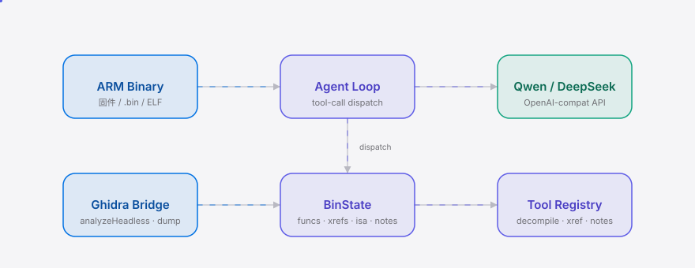
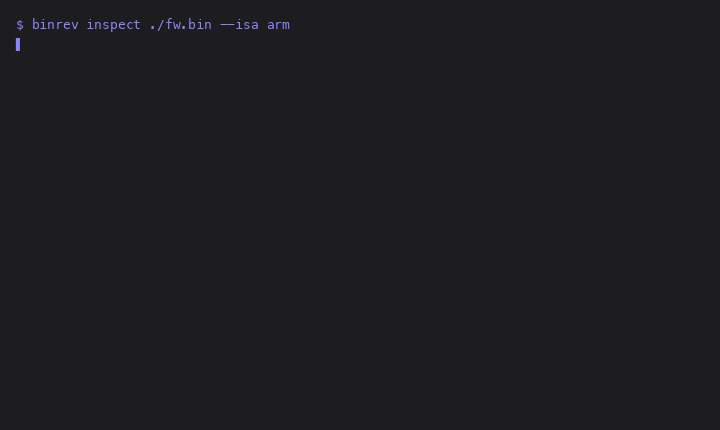

[English](./README.en.md) | **简体中文**

<picture>
  <source media="(prefers-color-scheme: dark)" srcset="./assets/hero-dark.svg">
  <source media="(prefers-color-scheme: light)" srcset="./assets/hero-light.svg">
  
</picture>

<p align="center"><sub>把 Claude Code 的动作空间扩展到国产芯片固件逆向的二进制动作空间 Agent。</sub></p>

<p align="center">
  <a href="./LICENSE"></a>
  <a href="https://github.com/SuperMarioYL/binrev/releases"></a>
  <a href="https://github.com/SuperMarioYL/binrev/actions/workflows/ci.yml"></a>
  
  
  
</p>

> **把反编译图、交叉引用、ISA 状态做成 agent 的一等上下文，而不是 Ghidra 的 stdout 日志。**

<h2> 架构</h2>

<picture>
  <source media="(prefers-color-scheme: dark)" srcset="./assets/atlas-dark.svg">
  <source media="(prefers-color-scheme: light)" srcset="./assets/atlas-light.svg">
  
</picture>

单进程 Python，一个 binary 一个 `BinState`。Ghidra 作为外部工具经 subprocess 调用（不进进程内）。Agent 用二进制动作空间（`decompile` / `xref` / `list_funcs` / `search_strings` / `set_note`）读写 `BinState`，而不是把 Ghidra stdout 当文本喂给模型。

<h2> 为什么是现在</h2>

Qwen 3.8 27B 在 30 分钟内完成一个逆向任务，证明模型能力已跨过"可做非平凡 RE"的门槛——瓶颈从"模型能否理解二进制"转移到了"Agent 动作空间能否承载二进制状态"。[affaan-m/ECC](https://github.com/affaan-m/ECC) 一直在追踪 Claude Code 的动作空间前沿，而 binrev 正是把它扩到 binary RE：把反编译图、交叉引用、ISA 状态做成 agent 可查可改的一等对象。国产 SoC、车机 ECU、信创固件以二进制形态交付且公开符号稀缺，这个 CN 表面叠在全球都缺的二进制动作原语上，不是"中文界面"那种可一键复制的表层本地化。

### vs Claude Code + Ghidra CLI

| 维度 | Claude Code + Ghidra CLI | binrev |
|---|---|---|
| 动作空间 | 文本 / shell（✓ 通用） | 二进制对象（✓） |
| 反编译图作上下文 | ✗ 读 stdout 日志 | ✓ 一等公民对象 |
| 交叉引用追踪 | ✗ 手工 | ✓ agent 自主追 |
| ISA / 调用约定状态 | ✗ | ✓ |
| 国产模型（Qwen / DeepSeek） | — | ✓ |
| 通用代码推理 | ✓（强） | —（仅二进制） |

<h2> 安装</h2>

```bash
python3 -m venv .venv && .venv/bin/pip install -e '.[dev]'   # 或 pipx install binrev
```

> v0.1 依赖 capstone（pip 自动安装）。Ghidra 为可选后端——未配置时 `inspect` 用 capstone 反汇编照样可用。

<h2> 快速开始</h2>

```bash
# 1. 构造一个最小 ARM 固件样本
python3 -c "import struct; open('fw.bin','wb').write(b''.join(struct.pack('<I',i) for i in [0xE92D4010,0xEB000001,0xE59F0010,0xE8BD8010,0xE92D4010,0xE3A0002A,0xE8BD8010]))"

# 2. 检视结构化二进制状态（函数表 + 交叉引用）
binrev inspect ./fw.bin --isa arm

# 3. 看某个被调用函数的反编译
binrev inspect ./fw.bin --isa arm --func 0x10
```

<details><summary>sample output</summary>

```
binrev inspect · ARM (A32) · 2 funcs · 1 xrefs · 0 strings · 0 notes · src=capstone

addr         name                   size  callers
--------------------------------------------------------
0x00000000  entry                    16  0
0x00000010  sub_00000010             12  1

function sub_00000010 @ 0x00000010  (12 bytes)

callers:
  0x00000004  (call)

decompilation:
  0x00000010:  push   {r4, lr}
  0x00000014:  mov    r0, #0x2a
  0x00000018:  pop    {r4, pc}
```
</details>

<h2> 用法</h2>

```bash
# 检视函数表
binrev inspect ./head_unit_firmware.bin --isa arm

# 检视指定函数（带调用者 + 反编译）
binrev inspect ./head_unit_firmware.bin --isa arm --func 0x4080

# 配置 Ghidra 后端 + Qwen/DeepSeek（可选）
binrev config set --ghidra /opt/ghidra --target qwen --api-key sk-...

# 跑 agent 会话，问"这个固件在干什么"（需要 LLM key）
binrev ./head_unit_firmware.bin --isa arm -q "这个固件在干什么 / main 调了哪些函数"
```

更多示例见 `examples/`。

<h2> 演示</h2>



asciinema 录制见 `demos/demo.cast`，VHS 脚本见 `docs/demo.tape`（CI 在 `demo.yml` 渲染 gif）。

<h2> 配置</h2>

配置文件位于 `~/.binrev/config.json`（`binrev config set` 持久化）。

| 键 | 类型 | 默认 | 含义 |
|---|---|---|---|
| `ghidra_path` | string \| null | null | Ghidra 安装目录（含 `support/analyzeHeadless`） |
| `llm.base_url` | string | DashScope | OpenAI 兼容端点 |
| `llm.api_key` | string | "" | Qwen / DeepSeek API key |
| `llm.model` | string | `qwen-plus` | 模型名 |
| `--target` | `qwen` \| `deepseek` | — | 预设模型族 |

<h2> 路线图</h2>

- [x] **m1** `BinState` 原语：加载 ARM binary → 反编译/xref/串表 → 结构化持有，`binrev inspect` 可读
- [ ] **m2** agent loop：Qwen/DeepSeek + 二进制动作空间工具集，交互会话答"这 binary 干什么"
- [ ] **m3** 车机 ECU 固件端到端 demo + asciinema 录制落地
- [ ] 多 ISA：x86 / LoongArch / MIPS / RISC-V
- [ ] 增量反编译、bindiff

<h2> 许可证</h2>

MIT，见 [LICENSE](./LICENSE)。欢迎在 [Issues](https://github.com/SuperMarioYL/binrev/issues) 提问或发 PR。

## 分享

```
binrev — the binary-action-space agent that extends Claude Code into 国产芯片固件逆向. 反编译图 + xrefs as first-class LLM context, not Ghidra stdout. Qwen/DeepSeek + ARM. https://github.com/SuperMarioYL/binrev
```

<p align="center"><sub><a href="./LICENSE">MIT</a> © 2026 SuperMarioYL</sub></p>
